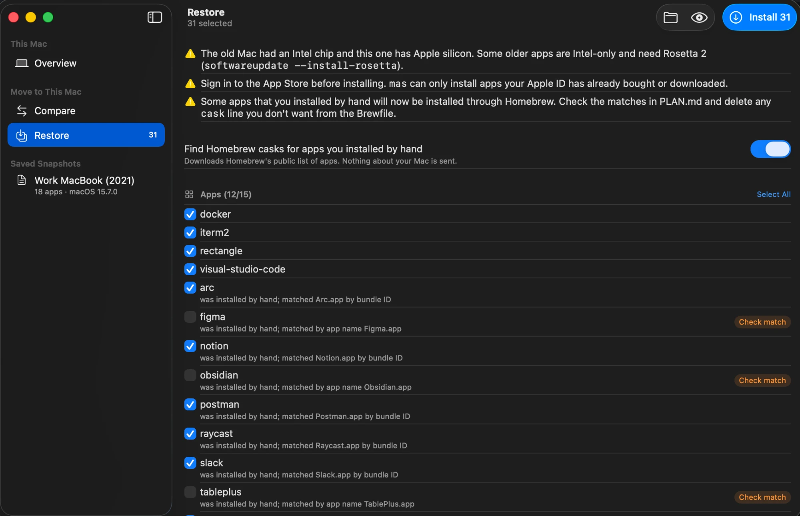
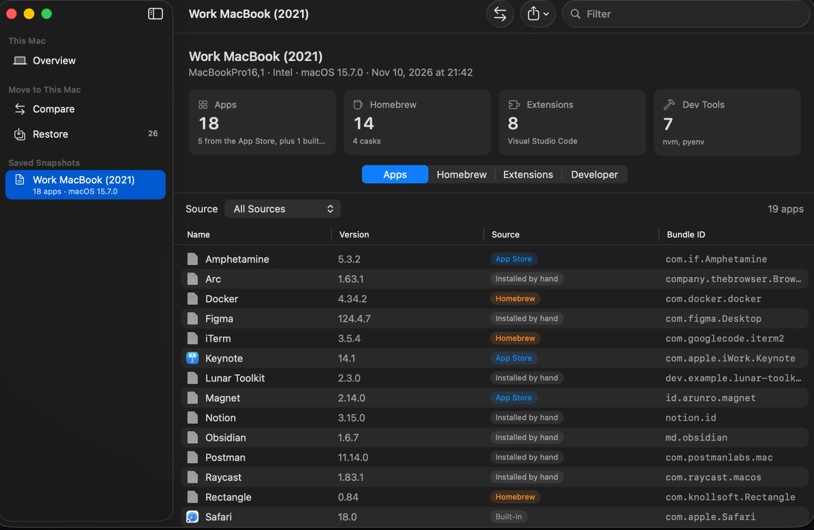
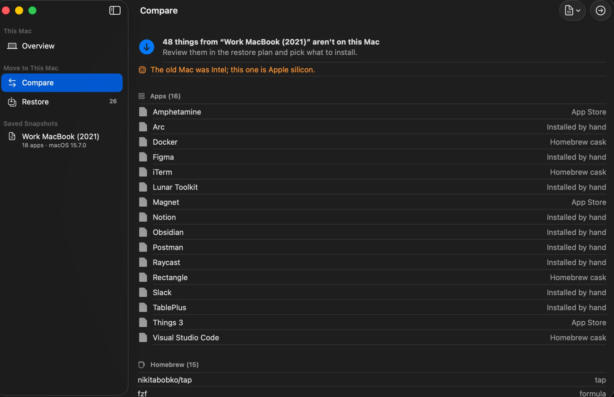

# MacBlueprint

**Set up your new Mac in minutes.** MacBlueprint scans the Mac you have and saves how it's set up into a single portable file. On your next Mac, it shows what's missing and turns it into an install plan you can read before anything runs.

[](https://github.com/erenahmettt/MacBlueprint/actions/workflows/ci.yml)


> **Status:** v0.3: a native macOS app and a command-line tool. See the [roadmap](#roadmap).



```
old Mac                                   new Mac
macblueprint scan -o old-mac.json   →   macblueprint restore old-mac.json --match-casks
                                          → PLAN.md · Brewfile · restore.sh
```

---

## Why

Setting up a new Mac or a fresh macOS install always comes with the same questions:

- Which apps did I use?
- Which Homebrew packages had I installed?
- Which VS Code extensions?
- Was Node installed with nvm or Homebrew?

Migration Assistant copies everything, junk included. `brew bundle dump` only knows about Homebrew. Dotfile managers assume you live in a terminal. MacBlueprint puts all of it in **one snapshot** you can read, diff and keep in git.

## What it captures

| Area | Details |
|---|---|
| **Apps** | Everything in `/Applications` and `~/Applications`, with bundle ID, version and source: App Store (including iPhone/iPad apps), Homebrew cask, built-in or manual |
| **Homebrew** | Taps, formulae you asked for (dependencies are tracked separately), casks |
| **Editors** | Extensions for VS Code, Cursor, VSCodium, Windsurf, Antigravity and Antigravity IDE |
| **Dev tools** | node, python, swift, go, rust, ruby, java, docker, … plus how each one was installed (nvm, pyenv, asdf, mise, Homebrew, …) |
| **Shell** | Login shell, oh-my-zsh / prezto / …, starship / powerlevel10k |

## Privacy first

Scanning is read-only and works offline. Restoring only writes files for you to review; MacBlueprint itself never installs anything. The one network request it can make is to download Homebrew's public cask list, and only when you pass `--match-casks`.

**It never reads:** `~/.ssh`, `~/.gnupg`, Keychains, `~/.aws`, `~/.config/gh`, `~/.kube`, `~/.docker`, `~/.netrc`, `~/.npmrc`, any `.env*` file, or App Store purchase metadata. The block is enforced in the file system layer ([`Exclusions.swift`](Sources/BlueprintCore/Privacy/Exclusions.swift)) and covered by tests, so a scanner can't bypass it by accident.

**Snapshots don't contain** your user name, your computer's name, passwords, keys or tokens. You choose a label yourself with `--label`.

It also never runs anything that could pop up an install prompt. On a Mac without the developer tools, `/usr/bin/git` and `/usr/bin/python3` open an "Install Command Line Tools" dialog, so MacBlueprint checks first.

## The app

MacBlueprint comes as a native SwiftUI app and as a command-line tool. Both use the same engine and produce the same files.

| Screen | What it does |
|---|---|
| **Overview** | Scans this Mac: apps with their real icons and where they came from, Homebrew, editor extensions, developer tools. Save the snapshot or export it as JSON or Markdown. |
| **Compare** | Open a snapshot of your old Mac (⌘O, or drop the file on the window) to see what this Mac is missing. |
| **Restore** | A checklist of everything that can be installed automatically, plus the steps that need you. Run a dry run, install with a live log, or export `PLAN.md`, `Brewfile` and `restore.sh`. Casks matched only by app name start unchecked. |

| Snapshot | Compare |
|---|---|
|  |  |

**No old Mac at hand?** Open [`Examples/work-macbook-2021.json`](Examples/work-macbook-2021.json) with ⌘O to try Compare and Restore against a sample snapshot, or run `macblueprint diff Examples/work-macbook-2021.json`. The screenshots above use it too.

The app isn't sandboxed (it needs to run `brew`), so it's distributed outside the Mac App Store.

## Install

Requires macOS 14 or later. Both downloads are universal (Apple silicon and Intel).

**With Homebrew:**

```bash
brew tap erenahmettt/tap && brew trust erenahmettt/tap
brew install --cask macblueprint     # the app
brew install --formula macblueprint  # the command-line tool
```

The app isn't notarized, so the cask clears macOS's quarantine flag after installing, the same thing you'd otherwise do by hand. The [tap's README](https://github.com/erenahmettt/homebrew-tap#why-a-separate-tap-and-why-the-trust-step) explains why and how to opt out.

**Or download it yourself:**

- **App:** download `MacBlueprint-<version>.zip` from the [latest release](https://github.com/erenahmettt/MacBlueprint/releases/latest), unzip it and move MacBlueprint to Applications. The app isn't notarized yet, so the first time you open it macOS will say it can't check it for malicious software. Open **System Settings → Privacy & Security** and click **Open Anyway**.

- **Command-line tool:** download `macblueprint-<version>-macos.zip` from the same release, then:

```bash
unzip macblueprint-*-macos.zip && sudo mv macblueprint /usr/local/bin/
```

**From source** (Swift 6, Xcode 16 or newer):

```bash
git clone https://github.com/erenahmettt/MacBlueprint.git
cd MacBlueprint
swift build -c release            # CLI: .build/release/macblueprint
open App/MacBlueprint.xcodeproj   # app: press ⌘R
```

## Usage

### 1. On the old Mac: take a snapshot

```bash
# Scan this Mac → macblueprint-2026-11-13-1030.json
macblueprint scan

# Name it and write a Markdown report next to it
macblueprint scan --label "Work MacBook" --markdown -o work-mac.json

# Print JSON to stdout (pipe it into jq, etc.)
macblueprint scan -o - | jq '.apps[] | select(.source == "manual") | .name'

# Turn an existing snapshot into a report
macblueprint export work-mac.json -o work-mac.md
```

Example output:

```
Scanning this Mac…

  Apps               22  (App Store 7, Homebrew 0, manual 15)
  Homebrew           not installed
  Editor extensions  10  (Visual Studio Code, Antigravity)
  Developer tools    git 2.50.1, java 27, node 24.13.1, python3 3.9.6, ruby 2.6.10, swift 6.2.4
  Version managers   nvm
```

### 2. On the new Mac: see what's missing

```bash
macblueprint diff old-mac.json               # compares with this Mac
macblueprint diff old-mac.json new-mac.json  # or with another snapshot (--json for scripts)
```

```
this Mac is missing 14 item(s) from "Old MacBook":

  Apps (4)
    - Raycast (installed by hand)
    - Magnet (App Store)
    ...
  Homebrew formulae (3)
    - git
    - nikitabobko/tap/aerospace
    - starship
  Visual Studio Code extensions (1)
    - esbenp.prettier-vscode
  Version managers (2)
    - nvm: v20.11.0
    - pyenv: 3.12.1
```

### 3. Restore: read the plan, then run it

```bash
macblueprint restore old-mac.json --match-casks
```

This writes three files to `macblueprint-restore/` and **runs nothing**:

| File | What it is |
|---|---|
| `PLAN.md` | A checklist: what will be installed, what needs you (apps without a cask, nvm/pyenv versions, oh-my-zsh, …) and warnings such as an Intel → Apple silicon move |
| `Brewfile` | Taps, formulae, casks and App Store apps for `brew bundle` |
| `restore.sh` | Installs the Brewfile and your editor extensions. Shows a summary and asks first, keeps going if one step fails, and supports `--dry-run` |

```bash
macblueprint-restore/restore.sh --dry-run   # see every command
macblueprint-restore/restore.sh             # install
```

**Finding casks for apps you installed by hand.** With `--match-casks`, apps you dragged into `/Applications` are matched to Homebrew casks: first by bundle ID, then by app name. Each match is labeled in the Brewfile, so you can delete the ones you don't want:

```ruby
cask "spotify"  # was installed by hand; matched Spotify.app by bundle ID
cask "zoom"     # was installed by hand; matched by app name zoom.us.app
```

Other options: `--against new-mac.json` compares with a snapshot instead of this Mac, and `--everything` plans the whole snapshot (for example, to rebuild a Mac from scratch).

<details>
<summary>Snapshot format (excerpt)</summary>

```json
{
  "schemaVersion": 1,
  "label": "Work MacBook",
  "machine": { "architecture": "arm64", "model": "Mac14,2", "osVersion": "26.6.2" },
  "apps": [
    {
      "name": "Xcode",
      "bundleId": "com.apple.dt.Xcode",
      "version": "26.3",
      "path": "/Applications/Xcode.app",
      "source": "appStore",
      "appStoreId": 497799835
    }
  ],
  "homebrew": { "installed": true, "taps": [], "formulae": [], "casks": [] },
  "editors": [
    { "editor": "vscode", "extensions": [{ "id": "ms-vscode.cpptools", "version": "1.32.2" }] }
  ],
  "devEnvironment": {
    "tools": [{ "name": "node", "version": "24.13.1", "manager": "nvm", "path": "…" }],
    "versionManagers": [{ "name": "nvm", "installedVersions": ["v24.13.1"] }]
  }
}
```

Keys are sorted and lists are ordered, so two snapshots diff cleanly in git.
</details>

## Architecture

```
MacBlueprint.app (SwiftUI)             macblueprint (CLI)
                 └──────────────┬──────────────┘
                          BlueprintCore
     Scanners ─► Snapshot (JSON) ─► SnapshotDiff ─► RestorePlan ─► PLAN.md · Brewfile · restore.sh
```

All logic lives in the `BlueprintCore` Swift package. The CLI and the upcoming app are thin layers on top. Scanners run in parallel, never throw, and report problems as warnings, so one broken tool never blocks a snapshot. A `RestorePlan` is plain data; exporters turn it into files, and running them is always your call.

Want to add a scanner or find your way around the code? Start with [CONTRIBUTING.md](CONTRIBUTING.md).

## Roadmap

- [x] **v0.1:** scan apps, Homebrew, editor extensions, dev tools and shell; export JSON and Markdown
- [x] **v0.2:** `diff` two snapshots; generate `Brewfile`, `restore.sh` (with `--dry-run`) and `PLAN.md`; match hand-installed apps to Homebrew casks
- [x] **v0.3:** SwiftUI app with scan, compare and selective restore; prebuilt universal releases
- [ ] **v1.0:** dotfiles with a secret scanner, curated macOS settings, signed and notarized releases

## Contributing

Contributions are welcome. Adding a new scanner (JetBrains plugins, `npm -g` packages, `pipx`, …) is a great first PR. See [CONTRIBUTING.md](CONTRIBUTING.md).

## License

[MIT](LICENSE)
